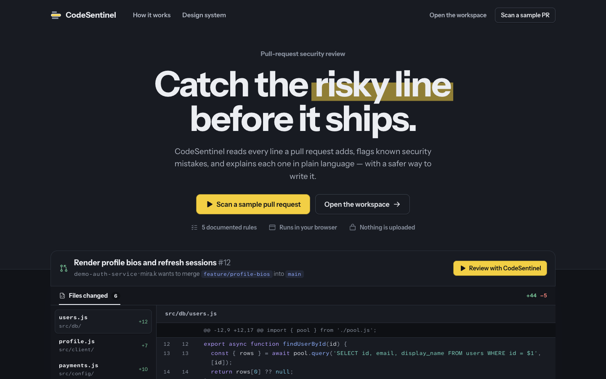
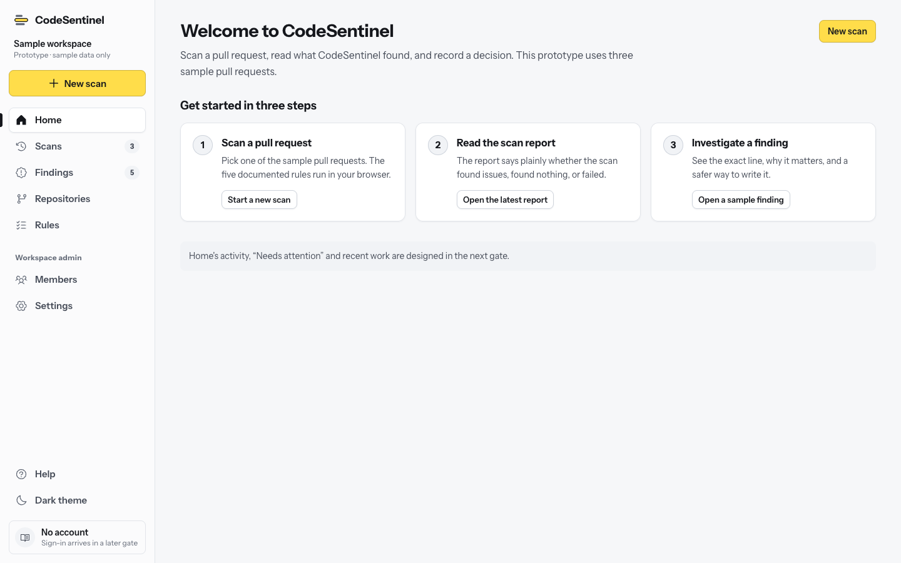
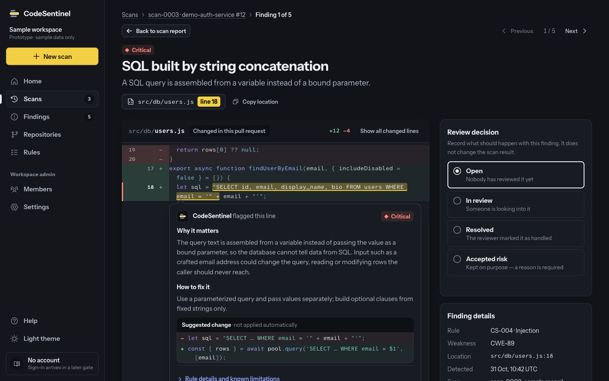
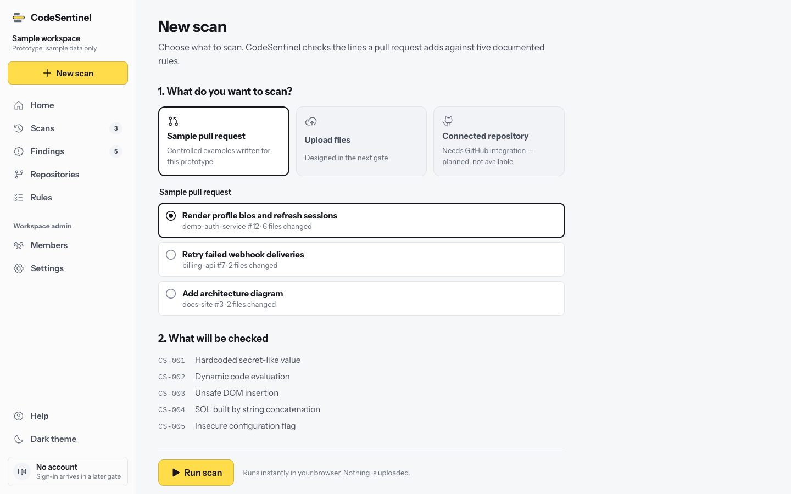
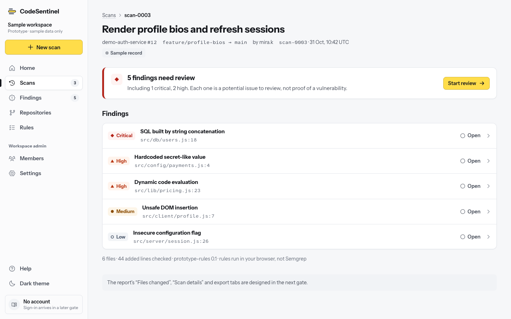

<div align="center">

# CodeSentinel

**Catch the risky line before it ships.**

A developer-focused pull-request security review prototype.




</div>

## Overview

CodeSentinel explores a simpler approach to identifying
and reviewing security issues before code is merged.

Highlight, the latest prototype, focuses on making security
findings understandable, actionable and easy to investigate
through a developer-oriented interface.

This version represents our first-month project milestone.

## Project Details

| Field | Details |
| --- | --- |
| Project ID | PST_PD_143 |
| Group | G385 |
| Track | Product Development |
| Institution | Polaris School of Technology |
| Mentor | Biplove |
| Team | Shubh Abhay Mohta, Harshvardhan Rajpurohit |
| Current Prototype | Highlight |

## Features

- Interactive pull-request security demonstration
- Five browser-based security detection rules
- Line-level evidence highlighting
- Guided security scanning workflow
- Detailed vulnerability investigation
- Suggested remediation approaches
- Finding review decisions
- Browser-local persistence
- Responsive light and dark interfaces
- Distinct outcomes for findings, no matches and failed scans

## Product Preview

### Developer Workspace



### Vulnerability Investigation



### New Scan



### Scan Report



## Technology Stack

| Technology | Purpose |
| --- | --- |
| React | Application interface |
| TypeScript | Type-safe application logic |
| Vite | Development and production builds |
| Vitest | Automated testing |
| React Router | Application navigation |
| Radix UI | Interactive interface primitives |
| Motion | Interface animations |
| CSS | Responsive design and styling |

## Getting Started

Clone the repository:

```bash
git clone https://github.com/ShubhJain09/codesentinel.git
cd codesentinel
```

Install dependencies:

```bash
npm ci
```

Start the development server:

```bash
npm run dev
```

Open http://localhost:5190 in your browser,
or use the URL displayed in your terminal.

## Verification

```bash
npm run typecheck
npm test
npm run build
```

Latest local verification:

- TypeScript checks passed
- 17 automated tests passed
- Production build completed successfully
- npm reported zero dependency vulnerabilities

The tests cover positive and negative rule matches,
sample pull requests, secret-evidence redaction,
repeatability, scan failures and highlight precision.

## Project Structure

```text
codesentinel/
├── public/
├── screenshots/
├── src/
│   ├── app/
│   ├── components/
│   ├── data/
│   ├── lib/
│   ├── site/
│   ├── styles/
│   └── main.tsx
├── package.json
├── package-lock.json
├── tsconfig.json
└── vite.config.ts
```

## Project Evolution

| Version | Description |
| --- | --- |
| [Original prototype](../../tree/prototype-v1) | Earlier implementation with Semgrep, authentication and webhook processing |
| Highlight | Latest design and usability prototype demonstrated in the first-month milestone |

The original implementation is preserved on the
`prototype-v1` branch for reference and future integration.

## Current Limitations

Highlight is a working frontend-focused prototype,
not a production-ready security platform.

- Detection runs locally using five pattern-based rules.
- Pull requests and repository data are controlled examples.
- Live GitHub integration and Semgrep are not connected
  to the Highlight interface yet.
- Review decisions are stored locally in the browser.
- Authentication and several workspace sections remain
  outside the current prototype scope.
- No configured rule matching does not guarantee secure code.

## Roadmap

- [x] Initial project architecture
- [x] Earlier static-analysis implementation
- [x] Developer workspace redesign
- [x] Interactive security review prototype
- [x] Automated prototype scanner tests
- [ ] Integrate Semgrep with Highlight
- [ ] Connect real GitHub pull requests
- [ ] Implement backend persistence and authentication
- [ ] Expand security detection coverage
- [ ] Continue accessibility and integration testing

---

<div align="center">

**CodeSentinel — Security before merge.**

Polaris School of Technology · Group G385

</div>
